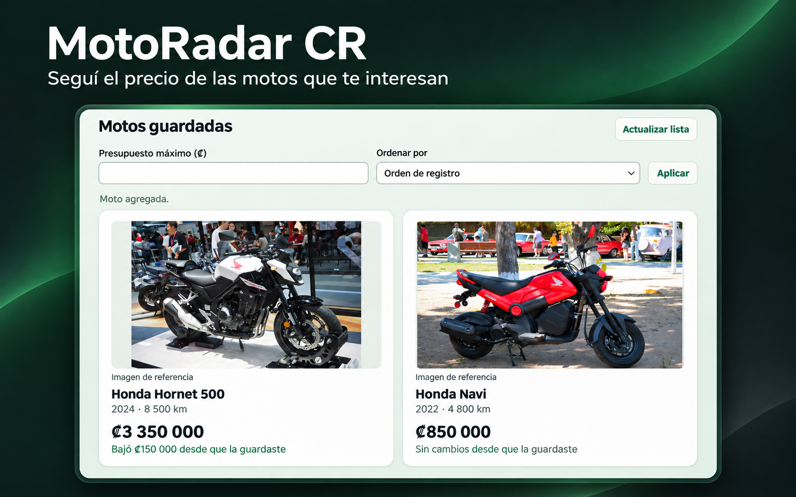
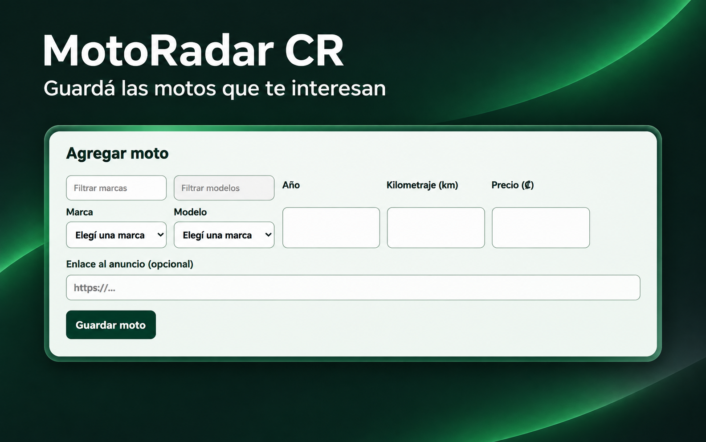

# MotoRadar CR

Registrá motos y seguí sus precios en colones. La interfaz usa HTML, CSS y JavaScript. Go sirve la página y la API, y SQLite guarda los datos en `moto-radar.db`.

## Iniciar y probar

Desde la raíz del proyecto, con Go 1.27.4 o una versión compatible:

```sh
go run .
```

Abrí [MotoRadar CR](http://localhost:8080/). Al arrancar, la app crea la base si hace falta y aplica la migración del enlace al anuncio a las bases existentes.

```sh
go test ./...
go build ./...
```

Las pruebas crean sus propias bases SQLite temporales.

## Fotos de referencia

Las tarjetas buscan fotos locales por marca, modelo y año. La búsqueda ignora mayúsculas, espacios y guiones. Si hay una foto para el año, se usa primero. Si no, se usa la referencia del mismo modelo cuando está disponible. La referencia de la Yamaha MT-03 corresponde a la generación de 321 cc, desde 2016. Las tarjetas sin referencia muestran «Sin imagen disponible».

El formulario permite elegir marcas y modelos de su catálogo local. Los filtros reducen las opciones visibles y el selector de modelos depende de la marca elegida. Los filtros no se guardan. Los registros anteriores siguen apareciendo en el listado. Si un nombre guardado quedó fuera del catálogo, elegí una opción válida al editarlo.

El catálogo inicial se amplió con modelos de Costa Rica a partir de [CRMotos](https://crmotos.com/sport-naked/), [CRMotos Touring](https://crmotos.com/touring/), [Yamaha Costa Rica](https://www.yamahacostarica.com/motos) y [Motos Fórmula, distribuida por Repuestos Gigante](https://motosformula.com/). La tarjeta de la Freedom ZS 200 enlaza a la [galería oficial de Freedom](https://www.motosfreedom.com/sport/zs200/) mientras se consigue una foto con permiso de redistribución.

Para ampliar el catálogo de fotos, buscá el modelo o su código en [Wikimedia Commons](https://commons.wikimedia.org/) o [Openverse](https://openverse.org/). Confirmá la licencia en la página original y registrá la fuente, el autor, la licencia y los cambios junto al archivo.

| Archivo en `imagenes/` | Fuente | Autor | Licencia | Cambios |
| --- | --- | --- | --- | --- |
| `honda-hornet-500.jpg` | [2023 Honda CB500 Hornet, Wikimedia Commons](https://commons.wikimedia.org/wiki/File:2023_Honda_CB500_Hornet.jpg) | Chanokchon | [CC BY-SA 4.0](https://creativecommons.org/licenses/by-sa/4.0/) | Copia original |
| `honda-hornet-500-2026.jpg` | [Honda CB500 Hornet 2026, Wikimedia Commons](https://commons.wikimedia.org/wiki/File:Honda_CB500_Hornet_2026.jpg) | MotorideSA | [CC BY-SA 4.0](https://creativecommons.org/licenses/by-sa/4.0/) | Copia original |
| `honda-navi.jpg` | [Honda Navi 100, Wikimedia Commons](https://commons.wikimedia.org/wiki/File:Honda_Navi_100.jpg) | RL GNZLZ | [CC BY-SA 2.0](https://creativecommons.org/licenses/by-sa/2.0/) | Copia original |
| `honda-africa-twin-1000.jpg` | [Honda CRF1000L, Wikimedia Commons](https://commons.wikimedia.org/wiki/File:Honda_CRF1000L.jpg) | Matteo Casarico | [CC BY-SA 4.0](https://creativecommons.org/licenses/by-sa/4.0/) | Versión de 960 px de Wikimedia |
| `honda-africa-twin-1100.jpg` | [2022 Honda CRF1100L Africa Twin, Wikimedia Commons](https://commons.wikimedia.org/wiki/File:2022_Honda_CRF1100L_Africa_Twin_in_Pearl_Glare_White_Tricolor,_front_right.jpg) | Mr.choppers | [CC BY-SA 4.0](https://creativecommons.org/licenses/by-sa/4.0/) | Versión de 960 px de Wikimedia |
| `bajaj-pulsar-ns200.jpg` | [Bajaj Pulsar 200 NS, Wikimedia Commons](https://commons.wikimedia.org/wiki/File:Bajaj_Pulsar_200_NS.jpg) | 25 Cents FC | [CC BY-SA 3.0](https://creativecommons.org/licenses/by-sa/3.0/) | Versión de 960 px de Wikimedia |
| `honda-nx500.jpg` | [2023 Honda NX500, Wikimedia Commons](https://commons.wikimedia.org/wiki/File:2023_Honda_NX500.jpg) | Chanokchon | [CC BY-SA 4.0](https://creativecommons.org/licenses/by-sa/4.0/) | Versión de 960 px de Wikimedia |
| `kawasaki-z500.jpg` | [Kawasaki Z500 (ER500) 2024, Wikimedia Commons](https://commons.wikimedia.org/wiki/File:Kawasaki_Z500_(ER500)_2024.jpg) | Revvnramen | [CC0 1.0](https://creativecommons.org/publicdomain/zero/1.0/) | Versión de 960 px de Wikimedia |
| `suzuki-v-strom-650.jpg` | [Wdog Suzuki V Strom 650, Wikimedia Commons](https://commons.wikimedia.org/wiki/File:Wdog_Suzuki_V_Strom_650.jpg) | wallerdog | [CC BY-SA 3.0](https://creativecommons.org/licenses/by-sa/3.0/) | Versión de 960 px de Wikimedia |
| `yamaha-mt-03.jpg` | [YAMAHA MT-03 at the Tokyo Motor Show 2015, Wikimedia Commons](https://commons.wikimedia.org/wiki/File:YAMAHA_MT-03_at_the_Tokyo_Motor_Show_2015.jpg) | PekePON | [CC BY-SA 4.0](https://creativecommons.org/licenses/by-sa/4.0/) | Versión de 960 px de Wikimedia |
| `yamaha-mt-07.jpg` | [Yamaha MT-07 2025, Wikimedia Commons](https://commons.wikimedia.org/wiki/File:Yamaha_MT-07_2025.jpg) | AVMOTO | [CC BY-SA 4.0](https://creativecommons.org/licenses/by-sa/4.0/) | Versión de 960 px de Wikimedia |

## API

| Método y ruta | Operación |
| --- | --- |
| `GET /motos` | Lista las motos por ID. |
| `GET /motos?precio_max=1200000` | Lista las motos con un precio igual o inferior al presupuesto. |
| `POST /motos` | Crea una moto y registra su precio inicial. |
| `GET /motos/{id}` | Devuelve una moto. |
| `PATCH /motos/{id}` | Edita los campos enviados y registra el precio si cambió. |
| `DELETE /motos/{id}` | Elimina la moto y su historial. |
| `GET /motos/{id}/precios` | Devuelve el historial, desde el primer precio registrado. |

Los campos editables son `marca`, `modelo`, `anio`, `kilometraje`, `precio_crc` y `anuncio_url`. El enlace es opcional y debe usar HTTP o HTTPS. Para quitarlo, enviá `{"anuncio_url":""}` en un PATCH. Por ejemplo, `{"kilometraje":0}` guarda cero kilómetros y conserva los demás datos.

## Vista previa

### Motos guardadas



### Agregar una moto

